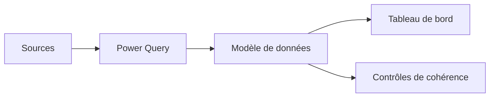
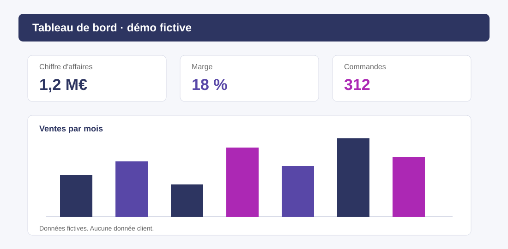

# Data et décisionnel

Du tableur au tableau de bord, avec des données propres et des décisions lisibles.

*Data and reporting: Excel, Power Query and Power BI, from spreadsheet to dashboard.*

## Ce que je peux faire pour vous

- **Conseil** : audit des données, cadrage des indicateurs, choix des outils.
- **Automatisation** : Power Query, automatisation Excel, modèles de tableaux de bord.
- **Formation** : Excel avancé, Power Query, Power BI pour débutants.

## Cas 1 · banque d'affaires et Power Query

### Contexte

Une banque d'affaires veut fiabiliser la préparation de ses données et réduire les manipulations manuelles dans Excel.

### Intervention

Formation Power Query, plusieurs journées, en 2026.

### Démarche

1. Partir de fichiers de travail anonymisés.
2. Construire des requêtes progressives.
3. Terminer par un cas complet de consolidation.

### Résultat

- Des requêtes réutilisables.
- Des fichiers de travail réutilisables.
- Une équipe autonome sur les transformations courantes.

### Point dur surmonté

Les niveaux étaient hétérogènes. Les fichiers ont été construits par étapes, avec un socle commun et des variantes.

## Cas 2 · industriel et Power BI

### Contexte

Un industriel veut un premier tableau de bord pour suivre son activité, sans compétence DAX dans l'équipe.

### Intervention

Formation Power BI, dans le cadre d'un parcours plus large, en 2026.

### Démarche

1. Vérifier la qualité des données.
2. Construire un modèle simple.
3. Créer un tableau de bord lisible.

### Résultat

- Un tableau de bord lisible.
- Des indicateurs compris par l'équipe.
- Un tableau de bord transposable.

### Point dur surmonté

L'équipe n'avait pas de compétence DAX. Le tableau de bord a été construit sans formule DAX, avec les transformations faites en amont.

## Cas 3 · groupe de communication et Excel avancé

### Contexte

Un groupe de communication veut gagner du temps sur ses reporting récurrents et ses manipulations Excel.

### Intervention

Formation Excel avancé et automatisation, en 2026.

### Démarche

1. Identifier les tâches répétitives.
2. Construire des tableaux croisés et des automatisations simples.
3. Tester sur des fichiers fictifs.

### Résultat

- Des reporting plus rapides.
- Des fichiers plus stables.
- Des équipes autonomes.

### Point dur surmonté

Les fichiers de départ étaient très différents d'une équipe à l'autre. Un socle commun a été posé avant les variantes.

## Architecture

## Démo exécutable

Une seule démo générique : [`demo/LAB-ventes.csv`](demo/LAB-ventes.csv) et [`demo/README.md`](demo/README.md). Douze lignes fictives, un parcours de démonstration, aucun fichier client.

## Captures de démos fictives

## Me contacter

- Site : https://next-gen-ai.fr
- LinkedIn : https://www.linkedin.com/in/adam-ai-011540356

---

*La démo est sous licence MIT, voir `LICENSE`. Le reste du contenu est sous tous droits réservés.*
